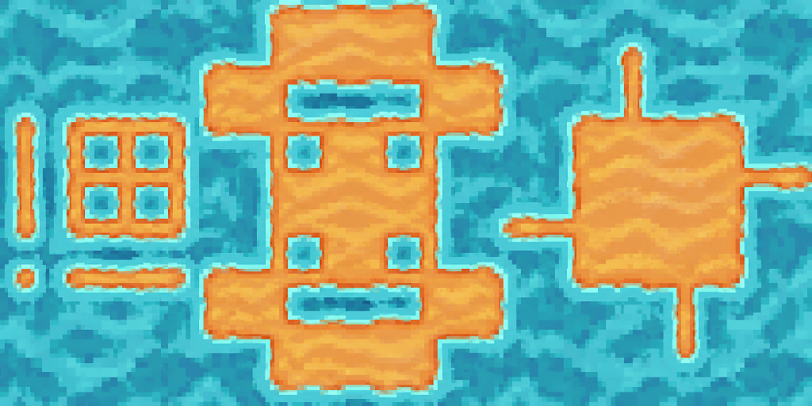

# AGAS 场景包

用于视频教程配套分享的 AGAS 场景压缩包集合。每个场景提供 ZIP、效果预览、中文使用步骤和校验值；后续场景继续加入 `scenes/`。

**AGAS 工具项目：[VOID-VVK/APP-AGAS-CS-Public](https://github.com/VOID-VVK/APP-AGAS-CS-Public)**。应用源码、后续获取方式与项目更新请以该仓库为准；这里存放配套场景资源。

> **兼容提醒：** 当前「Tile47 双图风格参考」需要支持 `AiStyleReference` 画风参考层的 AGAS 版本。本包已在本地开发版完成实际导出、导入和重开验证；截至 2026-11-05，[AGAS 公开主线](https://github.com/VOID-VVK/APP-AGAS-CS-Public)尚不包含此功能，也没有对应 GitHub Release。**目前没有已确认可下载的兼容正式版。** 本仓库不提供应用安装包；现阶段可先下载素材、查看提示词和流程，已有该开发版的用户可完整导入使用。不要把本包当成旧版可用的单参考图场景。

## 场景目录

| 场景 | 内容 | 下载与说明 |
| --- | --- | --- |
| **Tile47 · 沙地与水面** | 独立画风图 + 布局模板 → 1024×512 生成图 → 47 格标准图集 | [下载 ZIP](https://github.com/VOID-VVK/AGAS-SCENES/releases/download/tile47-sand-water-v1/tile47-sand-water-v1.zip) · [导入与使用](scenes/tile47-sand-water/README.md) · [校验值](scenes/tile47-sand-water/SHA256SUMS) |

这是双图生成流程示例。现有生成结果仍有纹理重复和部分色差接缝，不代表已完成无缝地形美术验收；用于游戏前应检查相邻瓦片、内角、窄通道和重复平铺效果。

## 第一次使用

1. 前往 [AGAS 工具项目](https://github.com/VOID-VVK/APP-AGAS-CS-Public)了解获取与运行方式，并确认你的构建支持双图画风参考层。公开主线暂不支持，兼容限制见上方；不能用下载本 ZIP 代替安装应用。
2. 下载单个场景 ZIP。在 AGAS 打开自己的工作项目，使用 **场景列表右键 → 导入场景包… → 选择 ZIP**，不必自行解压。
3. 导入会创建新场景，包含画风参考、Tile47 模板、生图结果三个图层，以及 7 个提示词片段和两个 Tile47 工具预设。
4. 选中「生图结果」层。在提示词中分别修改 **画风描述、材质 A、材质 B** 三个片段，保留其他四段固定规则。当前 A 是橙黄色沙地，B 是青蓝水面。
5. 网格设为 **64**，用 **Q** 从模板 `(0,0)` 框选 **16×8 格 / 1024×512**，不设置 W，也不框入左侧画风图。
6. 配置自己的图片模型连接后选择 **所有图层发送**：独立发送风格图→模板图，生成对应纹理。包内不含 API 连接或凭证。
7. 选中新生成图片，运行 **Tile47 标准图反推**，得到 **768×256** 标准图集。完整细节见[场景说明](scenes/tile47-sand-water/README.md)。

仅查看图片和提示词时无需运行 AGAS：[生成图](scenes/tile47-sand-water/preview.png)、[反推图集](scenes/tile47-sand-water/atlas-preview.png)、[完整提示词](scenes/tile47-sand-water/prompts.txt)均可直接打开。

## 验证与包内容

首个包经过真实 AGAS 实现的 **导出 ZIP → 空项目界面导入 → 保存 → 重开 → 双图请求准备 → 本地反推工具执行**。验证覆盖三张图原文件 SHA-256、7 个片段、图层角色和锁定状态、风格→模板发送顺序，以及 768×256 图集的 47 个有效槽位。验收没有调用付费图片模型。[查看验证记录](scenes/tile47-sand-water/verification.json)。

ZIP 只包含 `scene.json` 和本场景三张 PNG；两个原始 Tile47 工具定义保存在 manifest 内。不包含整个游戏项目、角色素材、运行截图、全局自定义工具箱或 AI 凭证。

素材与工具源码来源见 [THIRD_PARTY_NOTICES.md](THIRD_PARTY_NOTICES.md)。新增场景的约定见 [CONTRIBUTING.md](CONTRIBUTING.md)。
