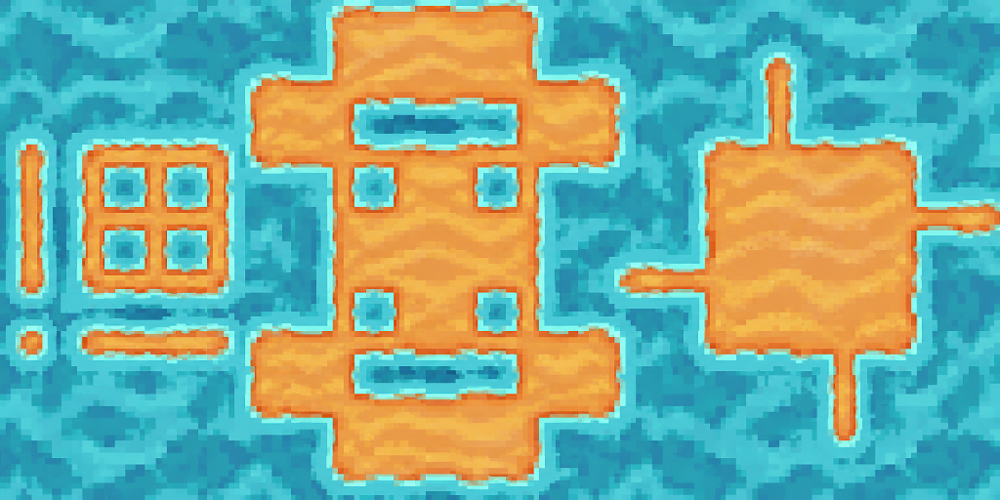
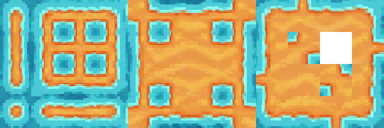

# Tile47 · 沙地与水面

[下载场景 ZIP](https://github.com/VOID-VVK/AGAS-SCENES/releases/download/tile47-sand-water-v1/tile47-sand-water-v1.zip) · [仓库内 ZIP](tile47-sand-water-v1.zip) · [SHA-256](SHA256SUMS) · [完整提示词](prompts.txt)

包版本：`tile47-sand-water-v1`。这是场景包版本，不是 AGAS 应用版本。

## 使用前确认版本

需要支持 **独立画风参考层 `AiStyleReference`**、场景 ZIP 导入，以及双图参考生成的 AGAS 版本。此包于 2026-11-05 在本地开发版、Godot 4.6.1 Mono 环境完成实际往返验证。测试构建基于提交 `563c87b91f6bf60f8fe465ddec621b36c8e189e5` 加本地未发布改动；这个提交本身不代表已包含双图支持。

[公开 AGAS 源码提交 `8daa0b7`](https://github.com/VOID-VVK/APP-AGAS-CS-Public/commit/8daa0b7c106952a42ec399882445f44d5315efec)现已包含独立画风参考层、双图请求和场景包支持，并使用本包发布时留存的场景副本复验实际导出、界面导入、保存重开、双图准备和本地反推。可按应用仓库 README 使用 Godot 4.6.1 .NET 版与 .NET 8 SDK 从源码运行。[Releases 页面](https://github.com/VOID-VVK/APP-AGAS-CS-Public/releases)目前没有对应的预编译应用；不要假定旧安装包支持本场景。

## 导入后有哪些内容

| 图层 | 内容 | 默认状态 |
| --- | --- | --- |
| 画风参考 · 沙地与水面 | 472×448 像素，橙黄色沙地与青蓝水面风格图 | 可见、锁定、共享；位于模板左侧、Q 外 |
| Tile47 模板 | 1024×512，亮粉红占形与黑色/透明背景 | 可见、锁定、共享；位置 `(0,0)`，原始大小，无旋转 |
| 生图结果 | 1024×512 的已有生成图，及 7 个提示词片段 | 可见、可编辑、共享；默认选中 |

包内还带有原始 **Tile47 标准图反推** 与 **Tile47 菱形俯视转换** 两个可编辑工具预设，没有预建工具链。当前源码通过工具链执行，此案例只需创建包含「标准图反推」一步的工具链。

发布副本特意将「生图结果」图层设为共享，以便 ZIP 包含已有生成示例。这个调整只发生在导出的内存副本，没有改变维护者原场景的共享设置。

场景包不携带项目网格设置、Q/W 框选、相机位置或 AI 连接。导入后请按以下步骤设置；没有自动恢复 Q 是正常现象。

## 导入与生成步骤

1. 在支持双图功能的 AGAS 中打开你的工作项目。
2. 从场景列表右键菜单选择 **导入场景包…**，选择下载的 ZIP。导入后会创建并选中新的 `Tile47-双图风格参考` 场景。
3. 选中 **生图结果** 图层，网格设为 **64**。
4. 按 **Q**，从模板的 `(0,0)` 框选 **16×8 格**，得到 **1024×512** 范围。不要设置 W 局部编辑框，也不要把左侧画风图框进去。
5. 保持画风层和模板层可见。右键选择 **所有图层发送**，使用支持图片参考的模型。连接地址、Key 和模型在你自己的 AGAS 中配置。
6. 实际发送的是两张独立图：**第 1 张是整张画风参考图，第 2 张是 Q 内的模板图**。已有生成结果不会遮住这次模板输入，输出尺寸只按模板的 1024×512。

缺少画风图、画风层放了多张图、使用 W，或模型不支持图片参考时，应先修正提示中的问题再生成。生成效果仍取决于模型对布局和材质要求的遵循程度。

## 哪些提示词可以改

「生图结果」图层包含 7 个启用的片段，顺序如下：

1. 固定规则：双图角色。
2. **可修改：画风描述。**
3. 固定规则：布局与占形。
4. **可修改：材质 A（粉红占形）。** 当前是橙黄色沙地。
5. **可修改：材质 B（黑色背景与内部空洞）。** 当前是青蓝水面。
6. 固定规则：无缝拼接。
7. 固定规则：画面与输出。

更换风格时，解锁画风层，移除原图并放入一张新图，再锁回且保持可见；同时修改第 2、4、5 段。保留固定规则、图序、模板布局和输出尺寸，避免只改材质名称却漏掉完整约束。

## 标准图集与效果限制

1. 打开工具箱管理面板，点击 **「+ 工具链」**，命名为 `Case1 Tile47 标准图反推`。
2. 在可选工具中选择 **「Tile47 标准图反推」**（ID：`tile47-standard-reverse`），点击 **「添加」**。执行顺序只保留这一项，点击 **「保存」**。
3. 回到画布，按 **E** 进入选择模式，选中新生成的 **1024×512** 图片，在图片上右键选择 **「工具箱 → Case1 Tile47 标准图反推」**。

工具箱管理面板用于编辑配置，运行入口在画布右键菜单。输出会加入画布并保存到工作项目的 `agas/tools/Tools N.png`，尺寸为 **768×256、12×4 槽、每格 64×64**；零基坐标 **`(10,1)`** 留透明，其他 47 槽有内容。此步骤在本地处理图片，不调用 AI。





现有结果可以演示流程，但仍有纹理重复和部分色差接缝。请检查连续地形、内角、窄通道、T 形和十字连接；本地反推只按布局复制像素，不会修复模型画错的边缘或材质。

PNG 不包含 Godot TileSet 的 terrain 连接配置；进入游戏前需要单独设置 Tile Size、图集格子大小与地形连接位。本包不包含游戏角色、地图或整个 Godot 工程。

## 已完成的实际验证

- 真实 `ScenePackageStore.Export` 导出 ZIP，空项目通过 AGAS 场景导入对话框导入，并保存、关闭、重新打开。
- 3 张图文件 SHA-256 不变，7 个片段内容/顺序/启用状态/角色不变；画风标记、图层锁定、可见性和选中结果层保留。
- 重开后实际执行画布 Capture 与请求 Prepare：Q 为 16×8 格、无 W，输出 1024×512，两张附件按风格→模板。
- 画风参考在 Q 外仍独立发送，更换它的内容会改变请求指纹；风格和已有结果不会混进模板。
- 原模板的全透明像素藏有 RGB 值，画布合成会把这些不可见颜色归零。因此捕获比较验证的是 **alpha 与所有可见像素一致**，并不声称捕获 PNG 逐字节相同；存储资源本身的 SHA-256 完整一致。
- 导入的原始反推工具实际运行成功，输出 768×256；47 个有效槽位有内容，保留槽 `(10,1)` 全透明。
- 验收未调用付费 AI，也未修改原项目、场景或素材。详细记录见 [verification.json](verification.json)。

macOS / Linux 下载后可在此目录执行：

```bash
shasum -a 256 -c SHA256SUMS
```

ZIP 的 SHA-256：`d0c38a0f1c585593a024d6f71cada1a2ab99ae50dc1050b58d3f959ade1345d4`。
